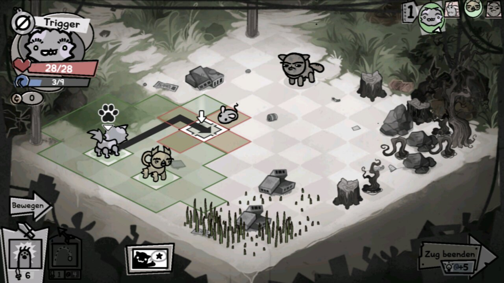
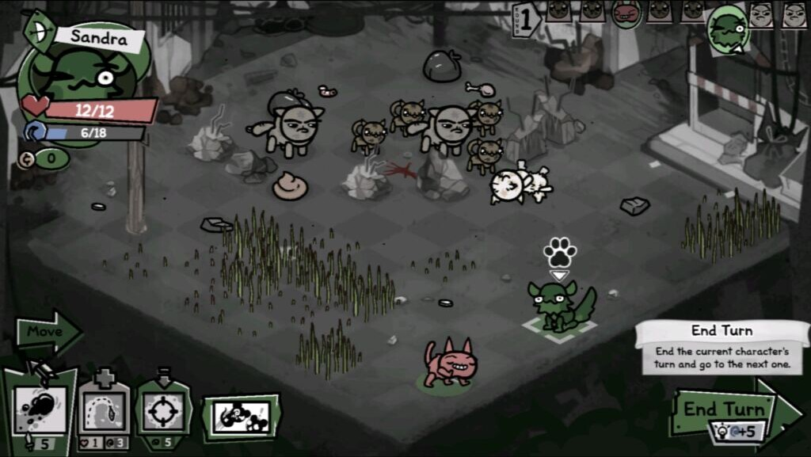
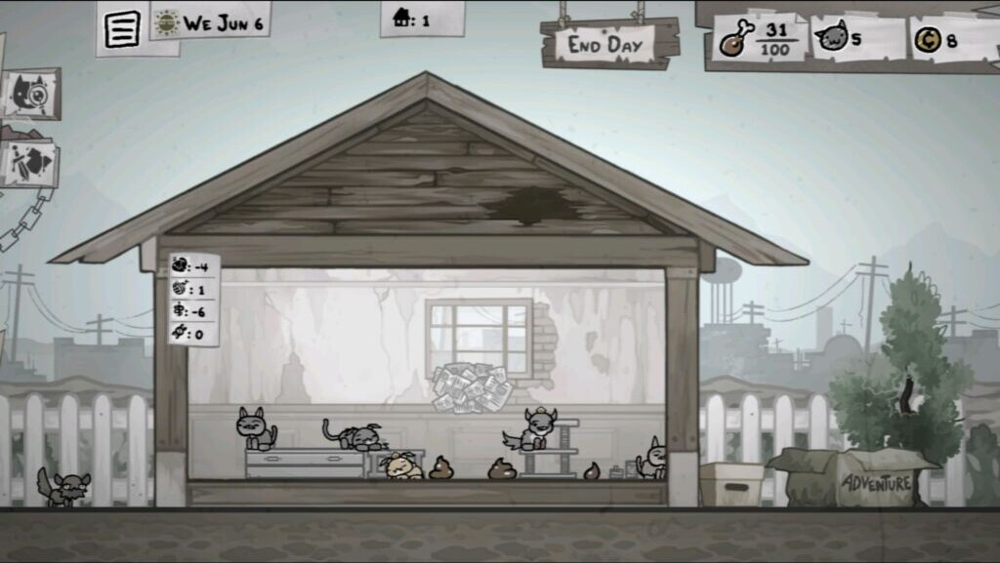
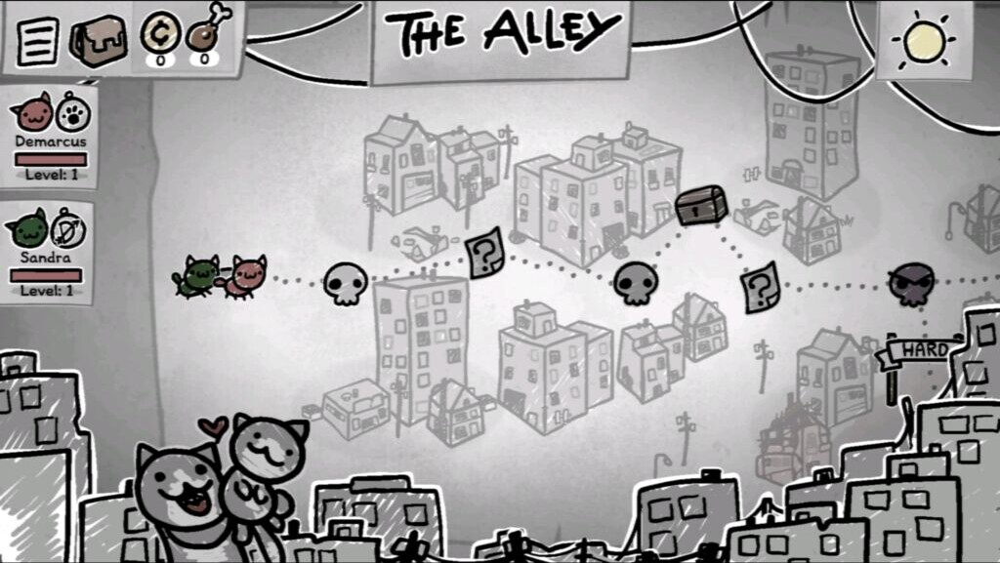
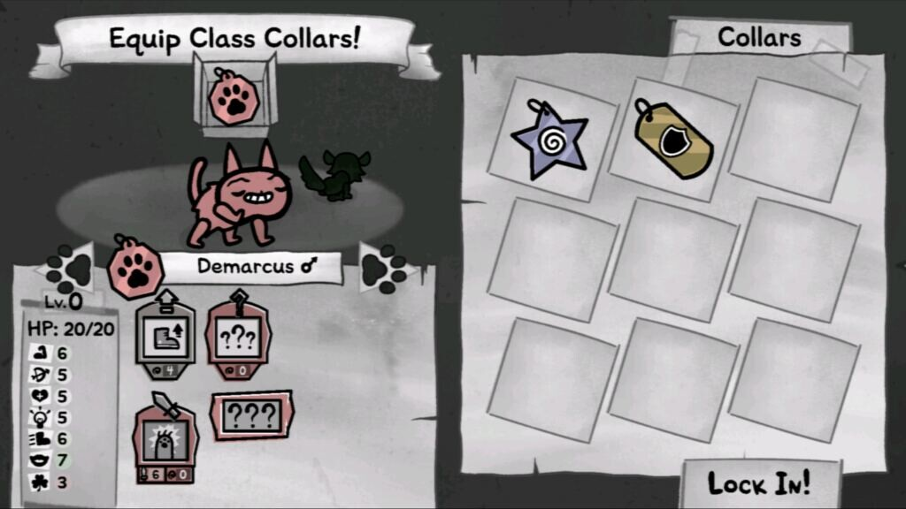
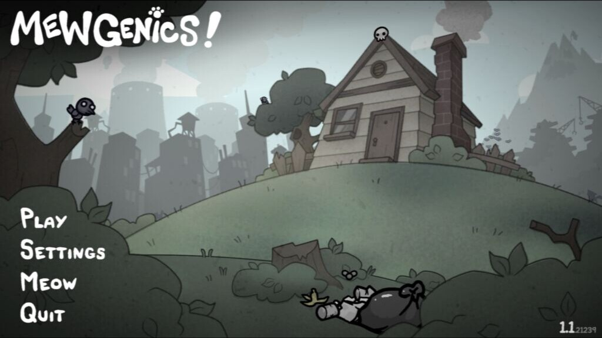

# Mewgenics – Android-Port (zum Selberbauen)

Die PC-Version von **Mewgenics** als native Android-App (arm64). Der Port ist eine **statische
Rekompilierung**: Der x86-64-Code der Steam-`Mewgenics.exe` wird vorab in C übersetzt und mit dem
Android-NDK nativ kompiliert. Er läuft auf einer eigenen kleinen Win64-Laufzeit mit SDL3 und
OpenGL ES – kein Emulator, kein Wine, kein Box64.

**Hier gibt es keine fertige APK und nichts vom Spiel.** Du baust die APK selbst aus **deiner
eigenen** Steam-Kopie: Der Build übersetzt deine `Mewgenics.exe` auf deinem Rechner. Dieses
Repository enthält nur Werkzeuge, die Laufzeit und Lift-Einstellungen für diesen Build (keinen
Spielcode). Die App liest die Spieldaten (`resources.gpak`) aus deiner Kopie auf dem Gerät. Die
gebaute APK enthält aus deiner EXE rekompilierten Code – sie ist für dich, nicht zum Weitergeben.
Mewgenics ist © Glaiel Games / Edmund McMillen und Tyler Glaiel; dieses Projekt steht in keiner
Verbindung zu ihnen.

*English version: [README.md](README.md)*

## Screenshots

<table>
  <tr>
    <td width="50%"><br><sub>Kampf mit Bewegungsvorschau auf dem Galaxy Z Fold8, 120 fps</sub></td>
    <td width="50%"><br><sub>Kampf in „The Alley“ (Galaxy Tab S8 Ultra)</sub></td>
  </tr>
  <tr>
    <td width="50%"><br><sub>Das Haus: Zucht, Tag beenden, die Abenteuerkiste</sub></td>
    <td width="50%"><br><sub>Abenteuerkarte</sub></td>
  </tr>
  <tr>
    <td width="50%"><br><sub>Klassen-Halsbänder, per Fingerziehen ausgerüstet</sub></td>
    <td width="50%"><br><sub>Hauptmenü</sub></td>
  </tr>
</table>

## Stand

Spielbar. Auf Geräten geprüft: Start, Menüs, Spielstände, Kampf-Tutorial, Karten-Ereignisse,
Inventar, Bosskampf, das Haus (Zucht, Tag beenden / Nacht / nächster Tag, Kätzchen), Abenteuer mit
Klassen-Halsbändern und Ausrüstung, Pausieren/Fortsetzen, „Speichern und Beenden“. Details und
Belege: [`port/RECOMP_STATUS.md`](port/RECOMP_STATUS.md).

| Gerät | GPU | Ergebnis |
|---|---|---|
| Galaxy Tab S8 Ultra (Android 16) | Adreno 730 | 60–120 fps |
| Galaxy Z Fold8 (Android 17) | Adreno 840 | 120 fps |

Voraussetzungen: arm64, Android 10+, OpenGL ES 3.1, etwa 8 GB RAM oder mehr (das Spiel braucht
mit dem eingebauten Sparprofil rund 3,5 GB), etwa 6 GB freier Speicher für die Spieldaten.

## Bauen

Du brauchst genau den Steam-Build, für den der Port gemacht ist: `Mewgenics.exe` **1.1.21239**,
SHA-256 `4127cd6a792ae528bca6f65a8873dd61789591937d87656c2b586a5e30eb77ea` (andere Builds
funktionieren nicht ohne Nacharbeit). Dazu Docker und rund 20 GB Platz.

```sh
git clone <dieses Repository> mewgenics-android && cd mewgenics-android
docker build -t mewgenics-build docker/                     # Werkzeuge + Android SDK/NDK
docker run --rm -v "$PWD":/w -v "/pfad/zu/steamapps/common/Mewgenics":/game:ro \
  mewgenics-build tools/build.sh /game/Mewgenics.exe
```

`tools/build.sh` holt die fest versionierten Fremdquellen (`tools/fetch_deps.sh`), katalogisiert und
übersetzt die EXE nach C (`gen/`, rund 56.000 Funktionen), kompiliert alles für arm64 (beim ersten
Mal 30–60 Minuten) und schreibt `out/Mewgenics-Android-<Version>.apk`. Mit eigenem Schlüssel
signieren: `MEW_KEYSTORE`, `MEW_KEYSTORE_PASSWORD`, `MEW_KEY_ALIAS`, `MEW_KEY_PASSWORD` setzen
(mit `-e` an `docker run` übergeben).

## Installieren und spielen

1. `adb install -r out/Mewgenics-Android-<Version>.apk`
2. `Mewgenics.exe` und `resources.gpak` (5,1 GB) aus deinem Steam-Ordner aufs Gerät bringen –
   entweder im Launcher über „Spieldaten importieren“ (Mewgenics-Ordner wählen) oder beide Dateien
   nach `Android/data/ch.plum.mewgenics/files/game/` oder `Android/obb/ch.plum.mewgenics/` kopieren.
3. „Mewgenics“ starten, „Spielen“ tippen. Der erste Start baut die Textur-Atlanten (rund 30 s).

Bedienung: Tippen = Klicken (auf einem Kampffeld zeigt das erste Tippen den Weg, das zweite
bestätigt – wie Maus-Hover und Klick im Original), mit einem Finger ziehen = Ziehen (Katzen ins Haus,
Gegenstände), Zwei-Finger-Tipp = Rechtsklick, Android-Zurück = Escape (Pausenmenü).

Das Spiel rendert mit höchstens 1920 px Breite und wird auf den Bildschirm skaliert; die
Launcher-Option „Volle Bildschirmauflösung“ rendert in voller Auflösung (schärfer, langsamer). Auf
Android wird in `settings.txt` ein Sparprofil erzwungen (`texture_scale_big 0.5`,
`curve_resolution 2.5`, kleinerer Sound-Cache, kein MSAA), weil manche Hersteller Vordergrund-Apps
über rund 4 GB anonymem Speicher beenden. Spielstände liegen in
`Android/data/ch.plum.mewgenics/files/user/`.

## Wie es funktioniert

- **Lift**: `generate64` von [pcrecomp](https://github.com/sp00nznet/pcrecomp) (fest versioniert,
  plus [`tools/patches/pcrecomp-mewgenics.patch`](tools/patches/pcrecomp-mewgenics.patch)) übersetzt
  jede Funktion nach C; `tools/directcalls.py` und `tools/shadowcpu.py` machen daraus direkte Aufrufe
  und halten die Register für die Geschwindigkeit in lokalen Variablen.
- **Laufzeit** (`runtime/src`): PE-Lader an der bevorzugten Basisadresse, TEB/PEB/TLS, der Teil von
  kernel32, den CRT und Spiel nutzen, Win32-GUI-Stubs, Steam-API-Stubs (auf Android gibt es kein
  Steam), Win64-Varargs-printf, Host-Ersatz für die heißesten Bibliotheksroutinen (miniz, stb_dxt).
- **SDL**: Das Spiel bindet SDL 3.2.12 statisch *mit dynapi* ein; die Laufzeit beantwortet
  `SDL_DYNAPI_entry` und füllt die Sprungtabelle mit Thunks auf das echte SDL3 unter Android.
- **OpenGL → GLES**: 3.293 generierte GL-Thunks (Khronos `gl.xml`); GLSL-150-Shader werden zur
  Laufzeit mit glslang + SPIRV-Cross nach ESSL 3.10 übersetzt; DXT-Texturen werden nach RGBA8
  dekodiert; Unterschiede bei Blit, Caps und Formaten behandelt `gl_es.c`.
- **Android-App** (`android/`): Launcher (Datenimport, Optionen) und eine SDL-Activity; die
  Touch→Maus-Zuordnung mit Rechtsklick und Ziehen steckt in `runtime/src/sdl_bridge.c`.

## Entwicklung

Ein Linux-Debug-Host (Xvfb + Mesa, Desktop-GL oder GLES) führt dieselbe Laufzeit und denselben
übersetzten Code aus: `tools/build_host_deps.sh`, `tools/build_stale.sh`, `tools/hostlink.sh`,
dann `GAME_DIR=/pfad/zu/Mewgenics tools/hostrun.sh <name> <sekunden>`. Debug-Schalter (`W64_*`-
Umgebungsvariablen: Tracing, GL-Fehlerprüfung, Profiler, Skript-Eingaben, Frame-Capture) und der
Ablauf auf Geräten stehen in [`AGENTS.md`](AGENTS.md).

## Lizenz

Der Code in diesem Repository steht unter MIT (siehe [`LICENSE`](LICENSE)). Fremdkomponenten und
ihre Lizenzen: [`THIRD_PARTY_NOTICES.md`](THIRD_PARTY_NOTICES.md). Das Spiel, sein Code und seine
Daten sind davon nicht erfasst und gehören ihren Eigentümern.
