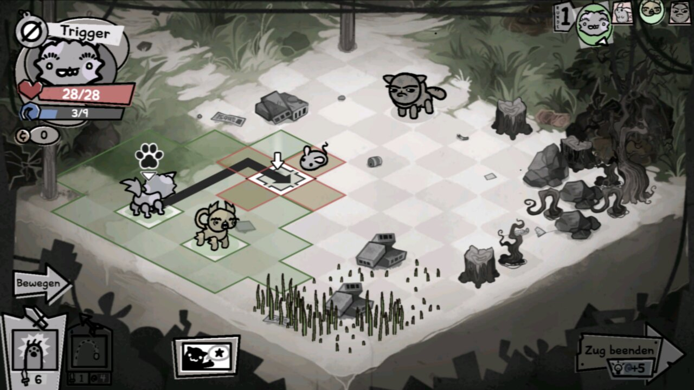
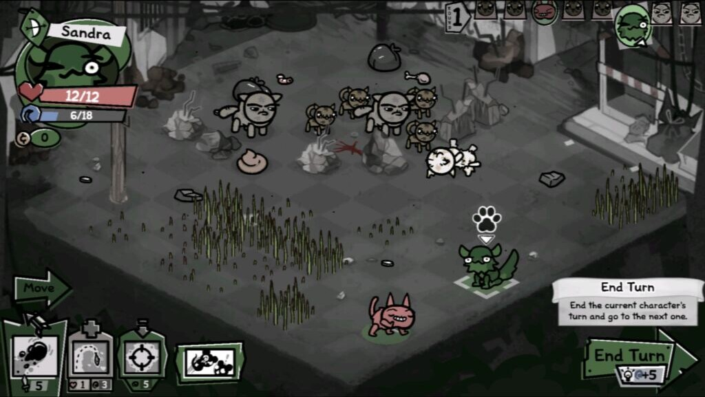
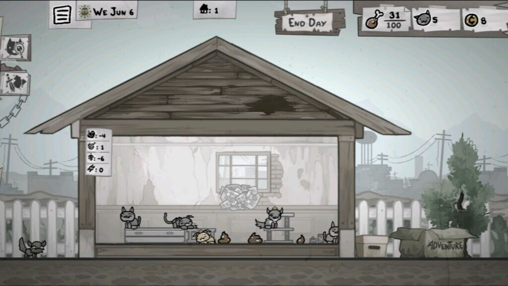
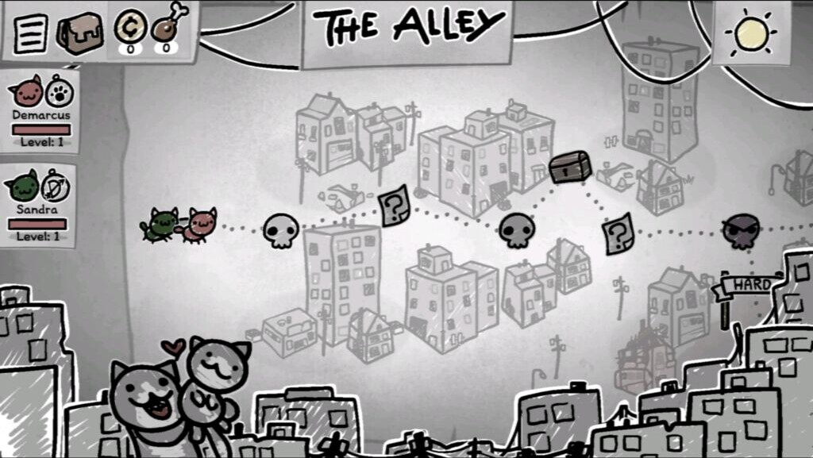
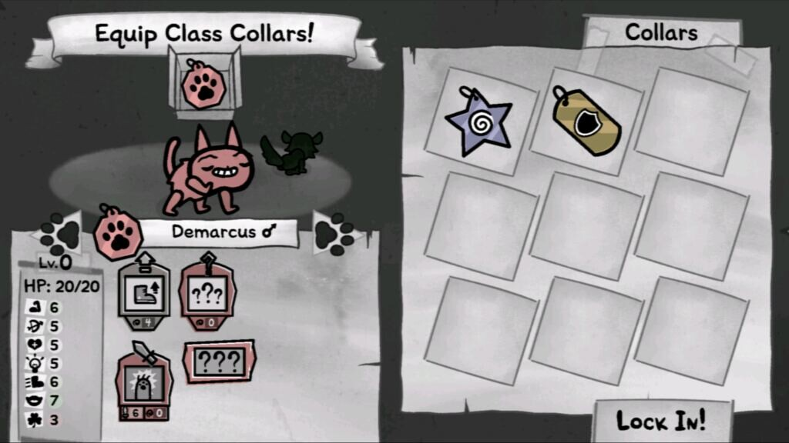
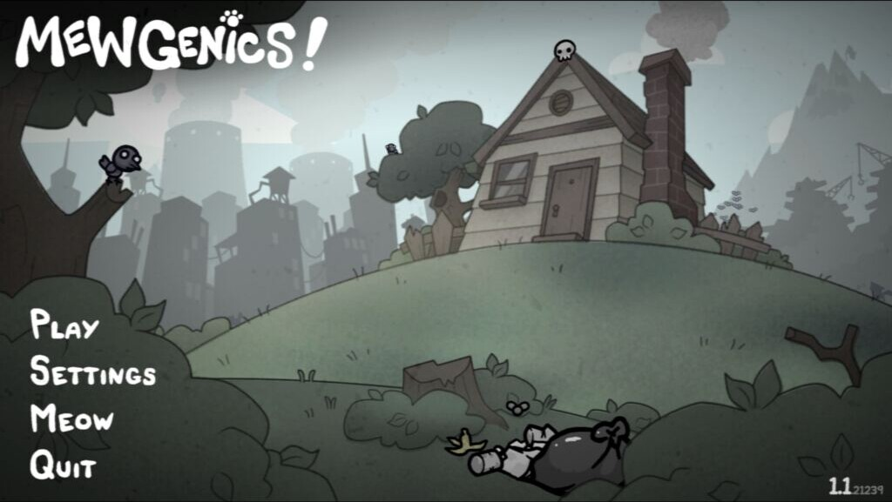

# Mewgenics – Android port (build it yourself)

An Android (arm64) port of the PC version of **Mewgenics**, made by statically recompiling the
Steam build's `Mewgenics.exe` (x86-64, Win64): the machine code is translated to C ahead of time
and compiled natively with the Android NDK. It runs on its own small Win64 runtime with SDL3 and
OpenGL ES — no emulator, no Wine, no Box64.

**There is no prebuilt APK here and nothing from the game.** You build the APK yourself from
**your own** Steam copy: the build translates your `Mewgenics.exe` on your machine. This repository
only holds tools, the runtime and per-build lift settings (no game code). The app reads the game
data (`resources.gpak`) from your copy on the device. The APK you build contains code recompiled
from your EXE, so it is for you, not for sharing. Mewgenics is © Glaiel Games / Edmund McMillen and
Tyler Glaiel; this project is not affiliated with or endorsed by them.

*Deutsche Version: [README.de.md](README.de.md)*

## Screenshots

<table>
  <tr>
    <td width="50%"><br><sub>Battle with move preview on a Galaxy Z Fold8 (German UI), 120 fps</sub></td>
    <td width="50%"><br><sub>Battle in The Alley (Galaxy Tab S8 Ultra)</sub></td>
  </tr>
  <tr>
    <td width="50%"><br><sub>The house: breeding, End Day, the adventure box</sub></td>
    <td width="50%"><br><sub>Adventure map</sub></td>
  </tr>
  <tr>
    <td width="50%"><br><sub>Class collars, equipped by dragging with a finger</sub></td>
    <td width="50%"><br><sub>Main menu</sub></td>
  </tr>
</table>

## Status

Playable. Verified on device: boot, menus, saves, the tutorial battle, map events, inventory,
boss fight, the house (breeding, End Day / night / next day, kittens), adventures with class
collars and equipment, suspend/resume, "Save and Quit". Details and evidence: [`port/RECOMP_STATUS.md`](port/RECOMP_STATUS.md).

| Device | GPU | Result |
|---|---|---|
| Galaxy Tab S8 Ultra (Android 16) | Adreno 730 | 60–120 fps |
| Galaxy Z Fold8 (Android 17) | Adreno 840 | 120 fps |

Requirements: arm64 Android 10+, OpenGL ES 3.1, ~8 GB RAM or more (the game uses ~3.5 GB with the
built-in low-memory profile), ~6 GB free storage for the game data.

## Build

You need the Steam build this port was made for: `Mewgenics.exe` **1.1.21239**, SHA-256
`4127cd6a792ae528bca6f65a8873dd61789591937d87656c2b586a5e30eb77ea`
(other builds will not work without re-doing the per-build fixes). Docker and ~20 GB of disk.

```sh
git clone <this repository> mewgenics-android && cd mewgenics-android
docker build -t mewgenics-build docker/                     # toolchain + Android SDK/NDK
docker run --rm -v "$PWD":/w -v "/path/to/steamapps/common/Mewgenics":/game:ro \
  mewgenics-build tools/build.sh /game/Mewgenics.exe
```

`tools/build.sh` fetches the pinned third-party sources (`tools/fetch_deps.sh`), catalogues and lifts
the executable to C (`gen/`, ~56,000 functions), compiles everything for arm64 (30–60 minutes the
first time) and writes `out/Mewgenics-Android-<version>.apk`. To sign with your own key set
`MEW_KEYSTORE`, `MEW_KEYSTORE_PASSWORD`, `MEW_KEY_ALIAS`, `MEW_KEY_PASSWORD` (pass them with `-e`).

## Install and play

1. `adb install -r out/Mewgenics-Android-<version>.apk`
2. Put `Mewgenics.exe` and `resources.gpak` (5.1 GB) from your Steam folder on the device — either
   in the launcher with "Spieldaten importieren" (pick the Mewgenics folder), or copy both files to
   `Android/data/ch.plum.mewgenics/files/game/` or `Android/obb/ch.plum.mewgenics/`.
3. Start "Mewgenics", tap "Spielen". The first start builds the texture atlases (~30 s).

Touch controls: tap = click (on a battle tile the first tap previews the move, the second confirms —
the game's own hover-then-click), drag with one finger = drag (cats into the house, items),
two-finger tap = right click, Android back = Escape (pause menu).

The game renders at up to 1920 px width and is scaled to the screen; the launcher option
"Volle Bildschirmauflösung" renders at full resolution (sharper, slower). On Android a low-memory
profile is forced in `settings.txt` (`texture_scale_big 0.5`, `curve_resolution 2.5`, smaller sound
cache, no MSAA), because some vendors kill foreground apps above ~4 GB of anonymous memory.
Saves live in `Android/data/ch.plum.mewgenics/files/user/`.

## How it works

- **Lift**: [pcrecomp](https://github.com/sp00nznet/pcrecomp)'s `generate64` (pinned, plus
  [`tools/patches/pcrecomp-mewgenics.patch`](tools/patches/pcrecomp-mewgenics.patch)) turns every
  function into C; `tools/directcalls.py` and `tools/shadowcpu.py` make direct calls and keep the
  register file in locals for speed.
- **Runtime** (`runtime/src`): PE loader at the preferred base, TEB/PEB/TLS, the kernel32 surface
  the CRT and game use, Win32 GUI stubs, Steam API stubs (there is no Steam on Android),
  Win64-varargs printf, host replacements for the hottest library code (miniz, stb_dxt).
- **SDL**: the game links SDL 3.2.12 statically *with dynapi*; the runtime answers
  `SDL_DYNAPI_entry` and fills its jump table with thunks to the real SDL3 on Android.
- **OpenGL → GLES**: 3,293 generated GL thunks (Khronos `gl.xml`); GLSL 150 shaders are translated to
  ESSL 3.10 at run time with glslang + SPIRV-Cross; DXT textures are decoded to RGBA8; blit, cap and
  format differences are handled in `gl_es.c`.
- **Android app** (`android/`): launcher (data import, options) + an SDL activity; touch → mouse
  mapping with right click and drag support lives in `runtime/src/sdl_bridge.c`.

Repository layout: `runtime/` Win64 runtime · `tools/` catalog, lift passes, generators, build
scripts · `config/` per-build lift settings · `host/` Linux debug host · `android/` the app ·
`docker/` build image · `port/RECOMP_STATUS.md` status/evidence · `AGENTS.md` developer notes.

## Development

A Linux debug host (Xvfb + Mesa, desktop GL or GLES) runs the same runtime and lifted code:
`tools/build_host_deps.sh`, `tools/build_stale.sh`, `tools/hostlink.sh`, then
`GAME_DIR=/path/to/Mewgenics tools/hostrun.sh <name> <seconds>`. Debug switches (`W64_*`
environment variables: tracing, GL error checks, profiler, scripted input, frame capture) and the
device workflow are described in [`AGENTS.md`](AGENTS.md).

## License

The code in this repository is MIT licensed (see [`LICENSE`](LICENSE)). Third-party components and
their licenses: [`THIRD_PARTY_NOTICES.md`](THIRD_PARTY_NOTICES.md). The game, its code and its data
are not covered and remain the property of their owners.
